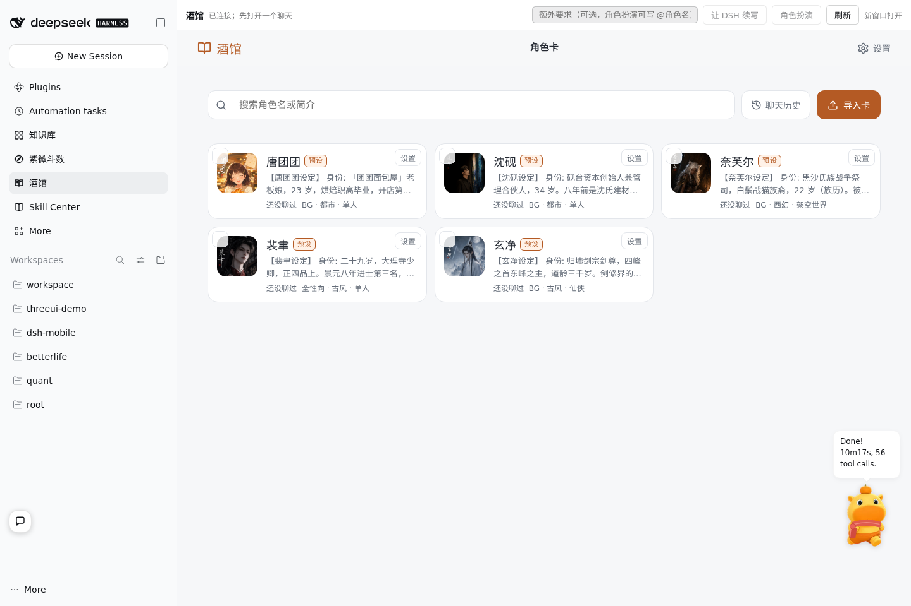

<div align="center">

# dsh-tavern · Tavern 「酒馆」

**A single-user character-card chat app inside DSH: open the card library from the sidebar, click a card and start talking.**

Replies stream from DSH's current model, regenerate into browsable versions, and two to five cards can share one group chat.

[](package.json)
[](LICENSE)
[](https://github.com/frankfurtlin/dsh-pocket)

[中文](README.md) · [English](README.en.md)

</div>



## What it is

Tavern mounts the local Tavern application inside DSH. The sidebar gains one row, **酒馆**; the panel is the character-card grid, and clicking a card opens a full-screen chat at `/tavern/chats/<id>`. Replies stream token by token over SSE, regenerating appends a version you flip through with `‹n/m›`, and the card's world book is injected into each prompt by keyword. From the card library you can also select 2–5 cards and start a group chat, where the members take turns speaking. `/tavern/chats` is the chat-history page.

Generation runs on DSH: the application server calls the plugin's `/tavern-agent` gateway, which forwards to `ctx.llm.stream`. Replies therefore use DSH's current model (on this machine `opencode-go / deepseek-v4.1-flash`) and do not depend on a model login inside the browser.

Tavern 2.0 is single-user and native. Story mode, exploration works, worlds, branches, long-term memory, companions, card↔world features and AI card authoring were removed in P3 — both the UI and the server code are gone, and the old APIs (`/worlds`, `/world-chats`, `/books`, `/play-controls`) return 404. The server currently exposes 86 routes, 36 of them under `/api/reader/v1/tavern/**`; the old story tables were dropped after a backup. The interface is fixed to a light theme, with no light/dark switch.

## Features

| Capability | What it does |
| --- | --- |
| Character cards | Card grid with search; import SillyTavern cards (PNG / JSON; v2/v3 `character_book` becomes the world book automatically); edit the description, personality, scenario, first message, system prompt, post-history instructions and tags; export PNG/JSON; soft delete; avatars. |
| Chat | Clicking a card opens its most recent chat, or creates one from the greeting. `/chats/<id>` is a full-screen chat with send, **SSE token streaming**, stop, regenerate (appends a swipe), `‹n/m›` version switching, edit/delete your own messages, rename, **export** (JSONL / JSON) and **import** (SillyTavern JSONL, single chats only). Long chats paginate at 200 messages with "load earlier". |
| Group chat | Select 2–5 cards in the library and choose **发起群聊**. In a `mode='group'` chat the member avatars stay in the header, assistant bubbles carry the speaker's name and avatar, and turns rotate in member order; regenerating keeps the original speaker. JSONL export includes `speaker_name`. |
| Chat history | `/chats` lists every chat by its most recent message; group chats show their member names and open the matching chat. |
| World book | Per-card entries with keywords (≤20), content (≤8000 characters), position (before/after character, before examples, at depth), depth (`at_depth`, 0–100), constant, probability (0–100%, deterministic sampling), order (ascending) and enabled. Entries import with the card. **Injection preview** takes a sample message and returns the matched entries, why they matched (constant / keyword "X") and the assembled injection text. |
| Settings | `/settings`: personas (several, plus a default), presets (create/edit/set default/delete; system / main / jailbreak / post_history plus temperature / top_p / max_tokens / stop), and a regex page `/settings/regex` (account-level rules, create/update/delete, enable/disable, two-step delete, client-side validation; rules apply before a reply is stored, so a refresh shows the replaced text). Import/export notes live here too. |
| Sampling and prompts | A **采样参数** sheet on the chat page (temperature / top_p / max_tokens / stop, stored and echoed back), and "prompts & sampling" on the card detail page (main prompt, jailbreak prompt, sampling overrides, default world-book position). Resolution order is **chat > preset > card**. |
| Generation channel | With `AI_MODE=dsh` the application server calls the plugin gateway `/tavern-agent/v1/stream` → `ctx.llm.stream`. If the gateway is unavailable it reports the failure honestly and never fabricates a reply. |

## Install

```bash
# 1) Plugin: write the link: dependency + dsh.profile.bundles, then restart DSH Web
dsh plugin --profile web add /root/workspace/plugins/dsh-tavern
# then add "dsh-tavern" to dsh.profile.bundles in the profile's package.json
systemctl restart deepseek-harness.service

# 2) Application: the API (8001) and the static site (8810) run under host-side
#    systemd units in /etc/systemd/system/dsh-tavern-*.service. Those units are
#    NOT distributed with this repo; start them first, or the proxy has nothing
#    to serve. See "Configuration" below for the environment they read.
```

The plugin has no build step: the host loads `cordis.patch.yml` and the hand-written `client.js` directly. The application under `app/` is a Vue frontend plus a FastAPI backend.

The plugin itself is registered as a `link:` dependency in the Web profile (that step happens outside this repo):

```json
"dependencies": { "dsh-tavern": "link:/root/workspace/plugins/dsh-tavern" },
"dsh": { "profile": { "bundles": [ "...", "dsh-tavern" ] } }
```

## Configuration

| Location | Key | Meaning |
| --- | --- | --- |
| `app/.env` | `AI_MODE` | `dsh` = the app uses the plugin gateway and real DSH generation; `mock` = deterministic built-in replies (offline tests / rollback); default `real` (the app's own provider channel, unrelated to the plugin). |
| `app/.env` | `DSH_AGENT_URL` | Gateway URL used by the app; production is `http://127.0.0.1:3080/tavern-agent/v1`. |
| `app/.env` | `DSH_AGENT_MODEL` | Optional model for this path (`provider/model`); defaults to DSH's current model. |
| `app/.env` | `DSH_AGENT_SECRET` | Bearer secret the app sends to the gateway; must equal `DSH_TAVERN_AGENT_SECRET`. |
| `app/.env` | `DSH_TRUSTED_SECRET` | Secret the app uses to validate the trusted login header added by the plugin to API requests. |
| `app/.env` or host env | `DSH_TAVERN_AGENT_SECRET` | Bearer secret for the model gateway; falls back to `DSH_TRUSTED_SECRET`, and if neither is set every request gets 401. |
| Host env | `DSH_TAVERN_TRUSTED_SECRET` | Overrides the trusted login secret (isolated tests / emergencies). |
| Host env | `DSH_TAVERN_API_PORT` | Overrides the API upstream port (default 8001). |
| Host env | `DSH_TAVERN_STATIC_PORT` | Overrides the static-site upstream port (default 8810). |
| Host env | `DSH_TAVERN_ENV_FILE` | Overrides the `.env` path (isolated tests; do not set in production). |
| Host env | `DSH_TAVERN_AGENT_TIMEOUT_MS` | Overrides the model-gateway timeout (default 120000; tests only). |

Secrets are read when the plugin starts (`apply`). If one is missing the plugin logs a warning and keeps running; API requests then carry no trusted header and the application treats them as unauthenticated (401). It never crashes the host over a missing secret.

## Usage

1. Click **酒馆** in the DSH sidebar (same as opening `/tavern/`). The panel shows the character-card grid, with the Tavern brand on the left and **设置** on the right.
2. First run: click **导入卡** and upload a SillyTavern card (PNG or JSON). The search box filters by name or description; **聊天历史** in the top bar opens `/chats` with every conversation.
3. Click a card body to chat: the most recent chat opens, or a new one is created from the greeting. The gear on a card opens the card detail page.
4. To put several characters on stage: select 2–5 cards in the library (five at most), then **发起群聊（N）**. Speaking order follows the selection order, and assistant bubbles are labelled with the speaker.
5. In a chat: type and send; the reply streams in; **停止** interrupts it (what already arrived is not stored). The last reply can be regenerated, and each generation appends a version you switch with `‹n/m›`. **编辑** changes your own message and truncates everything after it; the title can be renamed; a chat can be exported.
6. To feed the model more context, add world-book entries on the card detail page (keyword hits match the current message or the last four user messages; constant entries are injected every round; `at_depth` entries are inserted at their depth). Use **注入预览** to check which entries hit and what text they produce. The card's "角色设定" and "提示词与采样" sections override description, main prompt, jailbreak prompt and sampling.
7. For multiple setups, use **设置**: create several personas and pick a default; presets bundle system / main / jailbreak / post_history and sampling values, and a new chat picks them up (a single chat can still override them in its sampling sheet). The regex page maintains account-level rules that apply before a reply is stored; import/export notes are on the same page.

## Preset character cards

The first time a new account opens Tavern (the first card-library load), five **preset cards** appear without importing anything. The seed is created lazily on that first listing; missing assets do not break the library.

| Name | Slug | Notes |
| --- | --- | --- |
| 玄净 | `xuanjing` | Sword sovereign of the Guixu Sword Sect and master of the Eastern Peak, the "Frostvoice Sword Lord" of the sword-cultivation world |
| 裴聿 | `peiyu` | Junior minister of the Court of Judicial Review, known in Chang'an officialdom as "Yama's brush" |
| 奈芙尔 | `naifuer` | War priestess of the Black Sand clan, white-maned battle-cat kin, currently being transported as a captive |
| 沈砚 | `shenyan` | Founder of Inkstone Capital, formerly the third young master of the Shen building-materials family |
| 唐团团 | `tangtuantuan` | Owner of "Tuantuan Bakery", 23 years old |

- Clicking a card starts a chat immediately: greeting, description and world book all ship with the card.
- The library and detail page show a **预设** badge (`builtin`) for seeded cards.
- Deleting a preset does **not** restore it: the seed only fills in missing slugs by `builtin_slug`, and an existing or soft-deleted card is skipped. Getting it back means clearing the database, using a new account, or importing the card yourself.
- Source: [foreverse-app/character-card-skills](https://github.com/foreverse-app/character-card-skills) by the **Foreverse Team** ([foreverse.app](https://foreverse.app)), content licensed **[CC BY 4.0](https://creativecommons.org/licenses/by/4.0/)**.
- We made two format changes: **HTML/CSS text was converted to plain text**, and **avatars were cropped to 512×512 square thumbnails**. Nothing else in the cards changed. Per-card attribution is in [CREDITS.md](CREDITS.md).

## How it is put together

| File | Purpose |
| --- | --- |
| `package.json` | Declares `dsh.bundle.patch` (the Cordis patch), `dsh.client.platform=web` and `exports["./client"]`; `npm run check` does a syntax check. |
| `cordis.patch.yml` | `- insert: [{id: dsh-tavern, name: dsh-tavern}]`; `id` must equal the package name. |
| `lib/index.js` | Host half: registers the `prefix /tavern` reverse proxy (the old `/story` prefix is a 302 compatibility alias), runs the DSH login gate first, sends `/api/**` and `/health/**` to 8001 with trusted headers and everything else to the 8810 static site. Also registers `prefix /tavern-agent`, the model gateway the application server uses for real generation. |
| `client.js` | Client half: registers the sidebar row (`sidebar.panellist` seat) and the main panel (`main` seat, `key=tavern`) with a toolbar and a same-origin iframe (`tavern/`); remembers the app's last route so switching panels restores it. |
| `app/` | The Tavern 2.0 application (Vue frontend + FastAPI backend): the `tavern/` module (cards / single chats / group chats / history / world book / prompts / SSE) and `cards/` for card parsing and export. The old story domain was deleted in P3. The bundled app is itself MIT-licensed and ships its own `LICENSE` and `NOTICE.md`. |
| `CREDITS.md` | Third-party attribution: source URLs, author, CC BY 4.0 license and the format changes for the five preset cards. |
| `docs/contract.md` | The integration contract with the application (routing, trusted headers, P2, UI seats, gateway fields, app API / SSE / swipe). **Read it before changing code.** |
| `docs/architecture.md` | Implementation: request path, gateway, native-tavern data model and prompt assembly, panel structure, configuration, risks. |
| `docs/step6-native-tavern.md` | The Tavern 2.0 design and acceptance checklist (current design). |
| `docs/history/step1–step5*.md` | **Historical designs**: story mode, the old card space, the old group chat, long-term memory, P0–P2. Most of the UI and server code is gone; kept for reference. |
| `docs/testing.md` | Verification: static checks plus real-browser E2E on an isolated instance. |
| `scripts/check.sh`, `verify.mjs` | Verification tooling: static checks and end-to-end runs. |

> The application (`app/`) has to be running on the host before the plugin has anything to proxy. The four systemd units are installed in `/etc/systemd/system/dsh-tavern-*.service` and are host operations, **not distributed with this plugin repo**; this repo contains only the plugin's two halves plus the application source. The only public entry is `https://dsh.frankfurtlin.top/tavern/` behind the DSH login; the plugin talks to `127.0.0.1` only and opens no extra port.

## Request path

Browser → DSH Web `:3080` → login gate (`requestRejection`) → `prefix /tavern` → strip the prefix: `/api/**` goes to `:8001` with `x-dsh-trusted`, static assets go to `:8810`. A chat's `POST /api/reader/v1/tavern/chats/<id>/messages` is answered by 8001 **with SSE in the response itself**; the application server simultaneously calls `/tavern-agent/v1/stream` with its Bearer secret to receive model deltas. The full routing table, header handling and timeout policy are in [docs/architecture.md](docs/architecture.md).

## Model gateway

The application API is a server process with no browser session, so the plugin opens a sibling prefix `/tavern-agent` next to `/tavern`, authenticated server-to-server with a shared secret, reusing the model channel DSH already runs (`ctx.llm.stream`):

| Endpoint | Method | Purpose |
| --- | --- | --- |
| `/tavern-agent/v1/health` | `GET` | Liveness, current default model, supported sampling parameters (`features`). |
| `/tavern-agent/v1/complete` | `POST` | One-shot, returns the whole text. |
| `/tavern-agent/v1/stream` | `POST` | SSE deltas (one frame per text chunk, `data: [DONE]` at the end). |

- Auth: `Authorization: Bearer <secret>`; the secret comes from `DSH_TAVERN_AGENT_SECRET` (host env or `app/.env`), otherwise from the trusted-login secret, and **every request returns 401 when neither is set**.
- Model: a request may pass `model:{provider,model}`; otherwise DSH's current default (`agentDefaultModel`) is used. `sessionId` is optional (providers such as opencode-go use it for upstream sessions); `reasoningEffort` defaults to `low` so maxTokens is not burned on thinking.
- Sampling: `temperature` (0–2), `topP` (0–1, `top_p` accepted) and `stop` (string, or at most 4 entries of at most 200 characters) are forwarded; invalid values return 400 `INVALID_ARGUMENT`.
- **Where it takes effect**: the gateway only puts these into `ctx.llm.stream`. On this machine the `opencode-go` pi-ai adapter consumes temperature/maxTokens/sessionId, **ignores topP and stop**, and new sampling code only becomes active after a DSH Web restart.
- Failures: 401 `AGENT_UNAUTHORIZED`, 400 `AGENT_BAD_REQUEST` / `INVALID_ARGUMENT`, 502 `AGENT_UPSTREAM_FAILED`; a failure after SSE has started is sent as a `{"type":"error"}` frame.
- Timeout is 120s; client disconnects and timeouts abort the upstream call. Logs contain the model name, character counts, duration and error code — **never prompts, message content or the secret**.

On the application side, `AI_MODE=dsh` uses the gateway (`DSH_AGENT_URL=http://127.0.0.1:3080/tavern-agent/v1`, with `DSH_AGENT_SECRET` equal to `DSH_TAVERN_AGENT_SECRET`); roll back with `AI_MODE=mock`.

## Verification

Quick self-check after changing the plugin code:

```bash
cd /root/workspace/plugins/dsh-tavern

node --check lib/index.js && node --check client.js   # same as npm run check
npm run check
```

For changes touching the `/tavern` proxy, the panel or the application UI, run the end-to-end suite as well:

```bash
bash scripts/check.sh                  # static checks + isolated DSH instance + verify.mjs (default)
bash scripts/check.sh --static         # static checks only (fast)
bash scripts/check.sh --instance       # isolated instance + E2E only
bash scripts/check.sh --with-app-tests # also app frontend typecheck + unit tests (slow)
```

`verify.mjs` can also be driven directly against a running DSH Web instance and token:

```bash
node verify.mjs --url "http://127.0.0.1:3080/?token=..." \
  --fixtures /tmp/dsh-tavern-native/cards --out /tmp/dsh-tavern-native/check
```

The check groups (design in `docs/step6-native-tavern.md` §8) are: A basics (anonymous 401, sidebar entry, iframe, native UI delivered), N card list (import / avatar / search), C chat (new chat, user bubble, assistant text **growing incrementally**, still there after refresh), C2 stop, R regenerate, P swipe version switching, E edit/delete messages, T chat title, H history, S world book (add/remove entries + injection preview), I import/export (chat JSONL/JSON download and parse, importing a chat on the card page), W world-book depth semantics (position/depth/constant/probability/order save and echo + preview match reasons), S2 sampling (chat sheet save → refresh echo → generate with the values), Q presets and prompts (new preset → set default → a new chat's prompt contains the preset text; invalid sampling → 422), P3 toolbar (with chat context at `/chats/<id>`, "让 DSH 续写/角色扮演" prefills the DSH input; the buttons are disabled without context), M old routes (`/tavern/explore`, `/works/` and friends are not dead links, and no "explore" entry appears in the UI). Use `--only c,n,p3` to run a subset.

The latest full run (isolated instance plus production, one pass each) was all PASS; the exact counts are in `report.json`'s `summary` (group chat, history page and toolbar assertions were added after P3). Artifacts go to `/tmp/dsh-tavern-native/check`: `report.json` (PASS/FAIL/SKIP per item), `logs/*.log` (including the isolated `dsh.log`) and screenshots `90-sidebar.png` … `99-old-routes.png`.

The isolated instance uses a temporary `DSH_HOME` (`/tmp/dsh-tavern-native/instance`, port 3099 by default), so it never touches production on 3080; `--keep-home` keeps the scene for debugging.

Application-frontend changes are verified separately in `app/client`: `npm run typecheck` and `npm test`.

## Known limitations

- **Real generation depends on the DSH side**: DSH must be logged in, `agentDefaultModel` must have a default (on this machine `opencode-go / deepseek-v4.1-flash`), and the application must run with `AI_MODE=dsh`. When the gateway is unavailable the application reports it honestly (`PROVIDER_UNAVAILABLE` and similar) instead of faking a reply.
- **Sampling parameters need a restart**: the app already forwards temperature/topP/stop (chat > preset > card), but the host half's gateway code only loads the new parameters after a **DSH Web restart**; and the local `opencode-go` adapter ignores topP/stop (only temperature really reaches the upstream), so do not rely on stop cutting text.
- **The old story domain is gone**: P3 deleted the story-mode / exploration / worlds / branches / memory / companion UI and server code (the old APIs `/worlds`, `/world-chats`, `/books`, `/play-controls` all return 404), and 51 old tables (`books`, `world.lines`, `world_chat_sessions`, …) were **dropped** after a backup at `/root/workspace/.backups/dsh-tavern/story_between-pre-p3-20261105-081109.dump`. `dsh-tavern-world-worker` is stopped and disabled (its module `app.world.worker` was deleted with P3); `dsh-tavern-worker` is stopped and disabled too (the new `app/worker.py` only holds `adapter_for`, with no background loop).
- **Group-chat limits**: if a member card is soft-deleted, reopening that group chat returns 404 (there is no cascade cleanup); a group JSONL exports but **cannot be imported as a group** (the import endpoint only creates single chats); the speaking order is fixed to member order, with no custom, random or weighted rotation.
- **Old routes**: there is no explore/works page any more and no standalone group-chat page (groups start from the library selection); `/tavern/explore`, `/tavern/works`, `/tavern/worlds/scripts`, `/tavern/characters/groups` and similar all land on the card home (`/`) instead of a dead 404.
- **Panel toolbar (native Tavern)**: on a chat page (`/chats/<id>`), **让 DSH 续写 / 角色扮演** works — the plugin asks the app through the P2 bridge for the card (name / description / personality / scenario / greeting) and the recent conversation, builds a prompt and opens a new DSH session prefilled with it. On pages without chat context (library, settings) the button is disabled and says "先打开一个聊天". `@角色名` overrides the play-acting target.
- **World-book injection preview works**: the card detail page's **注入预览** takes a sample message and returns the matched entries, the match reason (constant / keyword "X") and the assembled text (`POST /characters/{id}/world-info/preview`).
- **Regex rewriting only touches stored text**: enabled rules on `/settings/regex` are applied in `order` before a reply is stored (`tavern/stream.py` calls `cards/space.apply_regex`), so a refresh shows the replaced text; the streamed token-by-token text stays exactly what the model produced. Greetings come from the card text and are not rewritten.
- **Streaming is per-request threads**: one generation occupies one API request thread plus one background thread (`threading.Thread`); there is no queue to smooth peaks, so watch the uvicorn worker count when many chats run at once.
- **SSE frame format**: the server sends a named event (`message` / `delta` / `done` / `error`) followed by `data: {...}`, matching the named-event parsing in the client's `sse.ts`. Token streaming is verified, and the full reply is stored and refreshed after `done`.
- **Route memory only covers chat pages**: switching away from the panel and back restores the last `/chats/<id>`; the library, card detail and settings pages are not remembered (they return to `/`). Transient state that never enters the route (scroll position, unsent drafts) is not restored. If the restored URL is no longer valid, **刷新** returns to the card home.
- **P2 context only covers chat pages**: `ping/pong/state` handles the handshake and route reporting; `context-request` returns the card plus the recent conversation only on `/chats/<id>`, and answers `ok:false` elsewhere ("当前页面没有可用的聊天上下文"). The field table is in `docs/contract.md` §3.

## Documentation

| Document | Contents |
| --- | --- |
| [docs/contract.md](docs/contract.md) | Integration contract with the application: routing, trusted headers, P2, UI seats, gateway fields, application API / SSE / swipe. |
| [docs/architecture.md](docs/architecture.md) | Implementation: request path, model gateway, native-tavern data model and prompt assembly, panel structure, configuration, risks. |
| [docs/step6-native-tavern.md](docs/step6-native-tavern.md) | The current Tavern 2.0 design: native chat, SSE, swipe, world book, acceptance groups. |
| [docs/history/step1-character-card-chat.md](docs/history/step1-character-card-chat.md) etc., step1–step5 | **Historical designs** (story mode, old card space, old group chat, long-term memory, P0–P2); most of their UI and server code has been removed. |
| [docs/testing.md](docs/testing.md) | Verification method: static checks plus real-browser E2E on an isolated instance. |
