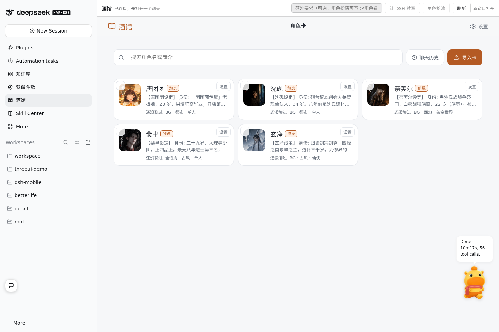

# dsh-tavern

A single-user character-card chat app inside DSH. Cards, single chats and 2–5 character group chats, streaming from DSH's current model.

**English** · [简体中文](README.zh-CN.md)

[](package.json)
[](LICENSE)



## The problem

A character-card app normally brings its own server, its own model configuration and its own login. If DSH already has the model, that is a second stack to keep running and a second bill to watch. This mounts the app in the DSH panel and generates through DSH's model channel, so a reply streams from the same default model as a normal session.

## Quick example

The app server has no browser session, so the plugin exposes a sibling gateway for it. That gateway is also the fastest way to see whether generation is wired up:

```console
$ curl -s -H "Authorization: Bearer $DSH_TAVERN_AGENT_SECRET" \
    http://127.0.0.1:3080/tavern-agent/v1/health
{"ok":true,"model":{"provider":"opencode-go","model":"deepseek-v4.1-flash"},
 "features":["temperature","topP","stop"]}
```

A stream request answers with `data: {"type":"delta","text":"…"}` frames and closes with `data: [DONE]`; the panel shows the text as it arrives.

## Install

The plugin is only half of it: the Tavern application has to run on the host as well.
The examples below use `/opt/dsh/dsh-tavern` as the checkout; that is a convention,
not a requirement — substitute your own path in the commands and in the units.

```bash
# 1) Plugin
dsh plugin --profile web add <path-to-your-checkout>
# then add "dsh-tavern" to dsh.profile.bundles, and restart DSH Web
systemctl restart deepseek-harness.service
```

The application is Python 3.12 + PostgreSQL, plus a built Vue client:

```bash
sudo git clone https://github.com/frankfurtlin/dsh-tavern /opt/dsh/dsh-tavern
cd /opt/dsh/dsh-tavern

python3.12 -m venv app/venv
app/venv/bin/pip install -r app/server/requirements.lock

# writes app/.env (mode 600, generated secrets) and never overwrites an existing one
python scripts/init-env.py
#   then edit app/.env: DATABASE_URL -> your PostgreSQL, AI_MODE=dsh,
#   DSH_AGENT_URL=http://127.0.0.1:3080/tavern-agent/v1,
#   DSH_AGENT_SECRET == DSH_TAVERN_AGENT_SECRET,
#   DSH_TRUSTED_AUTH=true, DSH_TRUSTED_SECRET == the host's DSH_TAVERN_TRUSTED_SECRET,
#   DSH_TRUSTED_USERNAME = an *existing* active account (no auto-signup, see
#   deploy/systemd/README.md)

# schema, then the client build
cd app/server && set -a && . ../.env && set +a && ../venv/bin/alembic upgrade head && cd ../..
cd app/client && npm ci && npm run build && cd ../..
```

Both application services ship as templates in this repo:

```bash
sudo cp deploy/systemd/dsh-tavern-api.service.example /etc/systemd/system/dsh-tavern-api.service
sudo cp deploy/systemd/dsh-tavern-web.service.example /etc/systemd/system/dsh-tavern-web.service
sudo systemctl daemon-reload
sudo systemctl enable --now dsh-tavern-api dsh-tavern-web
curl -s http://127.0.0.1:8001/health/ready
```

That is the API on `127.0.0.1:8001` and the static site on `127.0.0.1:8810`; without
them the panel proxies to a dead port. Replace `/opt/dsh/dsh-tavern` in each copied
unit with your checkout path. `deploy/systemd/README.md` documents every field, the
PostgreSQL prerequisite, and why the two legacy worker units under
`deploy/systemd/legacy/` must stay disabled.

The plugin has no build step; the host loads `cordis.patch.yml` and the hand-written `client.js`.

## Usage

1. Click **酒馆** in the DSH sidebar. The panel is the character library; the top bar has the brand, **聊天历史** and **设置**.
2. First run: **导入卡** takes a SillyTavern card (PNG or JSON). A v2/v3 `character_book` becomes the card's world book. The search box filters by name and description.
3. Click a card to open its most recent chat, or a new one built from the greeting. Replies stream in; **停止** interrupts, **重新生成** appends a version you switch with `‹n/m›`. Your own messages can be edited, and a chat can be renamed, exported (JSONL/JSON) or imported (SillyTavern JSONL, single chats only).
4. World book: entries on the card detail page inject by keyword, always, or at a depth. **注入预览** shows which entries hit, why, and the text that would be injected.
5. Group chat: select 2–5 cards in the library and choose **发起群聊**. Turns rotate in member order, and assistant bubbles are labelled with the speaker.
6. Settings: multiple personas, presets (system / main / jailbreak / post_history plus sampling), and account-level regex rules that apply before a reply is stored.

## Configuration

| Key | Where | Meaning |
| --- | --- | --- |
| `AI_MODE` | `app/.env` | `dsh` generates through the plugin gateway; `mock` returns deterministic test replies; `real` uses the app's own provider, unrelated to this plugin. |
| `DSH_AGENT_URL` | `app/.env` | Gateway URL used by the app. Production is `http://127.0.0.1:3080/tavern-agent/v1`. |
| `DSH_AGENT_SECRET` | `app/.env` | Bearer secret the app sends. Must match `DSH_TAVERN_AGENT_SECRET`. |
| `DSH_TAVERN_AGENT_SECRET` | `app/.env` or host env | Bearer secret the gateway checks. Falls back to `DSH_TRUSTED_SECRET`; if neither is set, every gateway request is 401. |
| `DSH_TAVERN_TRUSTED_SECRET` | host env | Overrides the trusted-login secret the plugin adds to proxied API requests. |
| `DSH_TAVERN_API_PORT` | host env | API upstream port. Default `8001`. |
| `DSH_TAVERN_STATIC_PORT` | host env | Static-site upstream port. Default `8810`. |
| `DSH_TAVERN_AGENT_TIMEOUT_MS` | host env | Gateway timeout. Default `120000`; tests only. |

Secrets are read when the plugin starts. A missing secret logs a warning and keeps the host alive; API requests then carry no trusted header and the app returns 401. The full key list, including the app-side trusted secret and the test-only `.env` override, is in the Chinese README.

## What it doesn't do

- It does not run the application for you. The repo ships the two unit templates and the build steps, but the services and the PostgreSQL they need are host configuration that you install and keep running.
- It does not manage your model. Generation needs a logged-in DSH with a default model and `AI_MODE=dsh`; when the gateway is down the app reports the error and never fabricates a reply.
- Sampling is partly upstream-limited: the local `opencode-go` adapter consumes temperature but ignores topP and stop, and host-half changes only take effect after a DSH restart.
- Single user only: no account system inside the app, and the interface is fixed to a light theme and Chinese only.
- Group chats are imperfect: a soft-deleted member card makes the chat return 404, a group JSONL cannot be imported back as a group, and turn order is fixed.
- No story mode, worlds, branches or long-term memory any more. P3 removed them; the old routes land on the card library instead of 404ing.

## Docs

The Chinese README keeps the deep sections: request path, gateway fields, preset-card attribution (CC BY 4.0), verification groups and the full limitations: [README.zh-CN.md](README.zh-CN.md). Reference: [docs/contract.md](docs/contract.md), [docs/architecture.md](docs/architecture.md), [docs/testing.md](docs/testing.md).

## Contributing

Run `npm run check` for any patch. For changes to the proxy, the panel or the UI, run `bash scripts/check.sh`, which starts an isolated DSH instance and drives the real-browser E2E suite. Preset cards are third-party content; keep their attribution in [CREDITS.md](CREDITS.md) intact.

## License

MIT. See [LICENSE](LICENSE).
