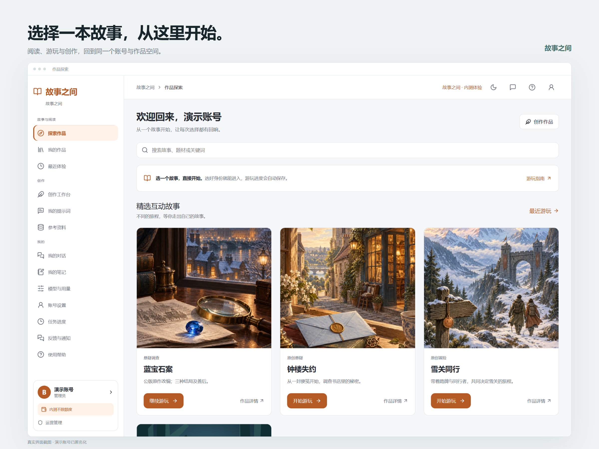
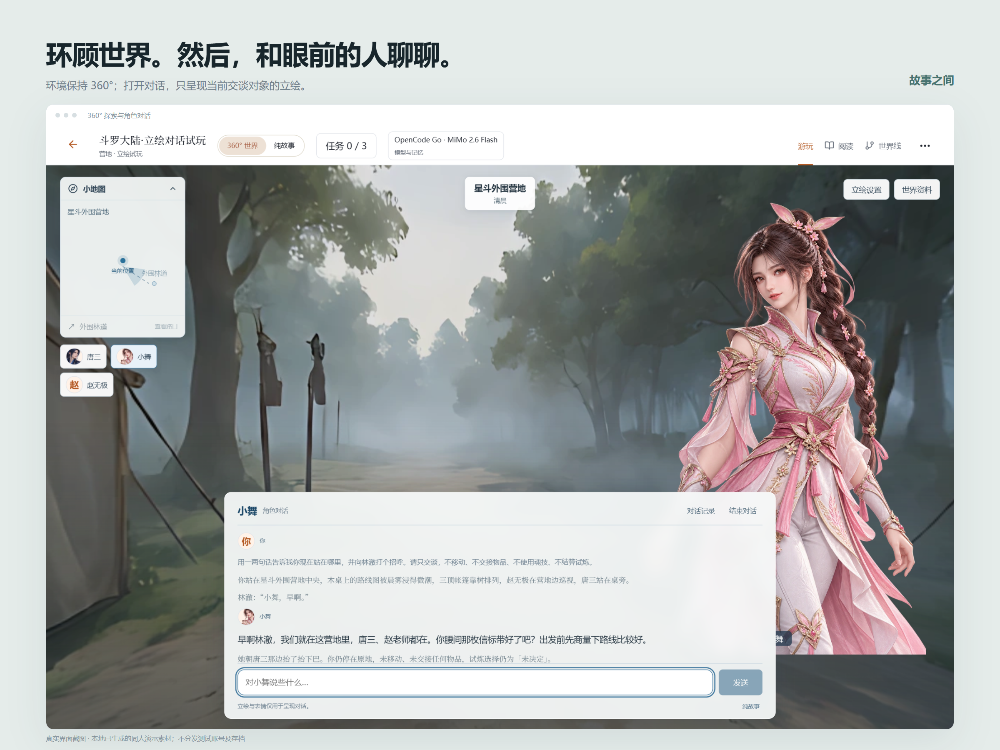
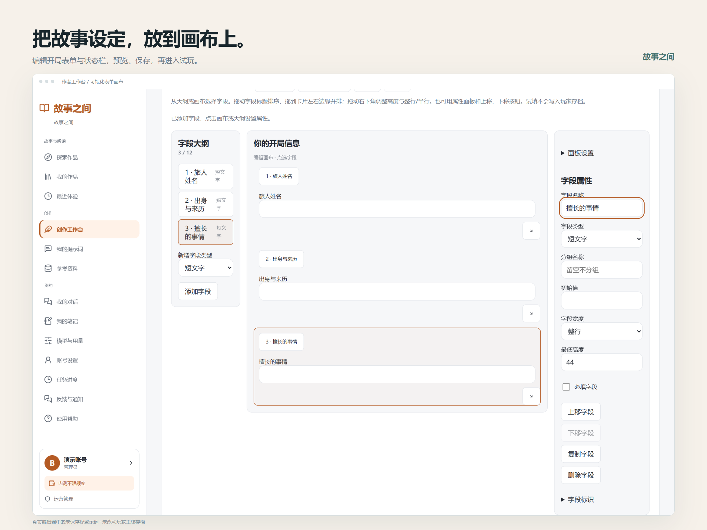
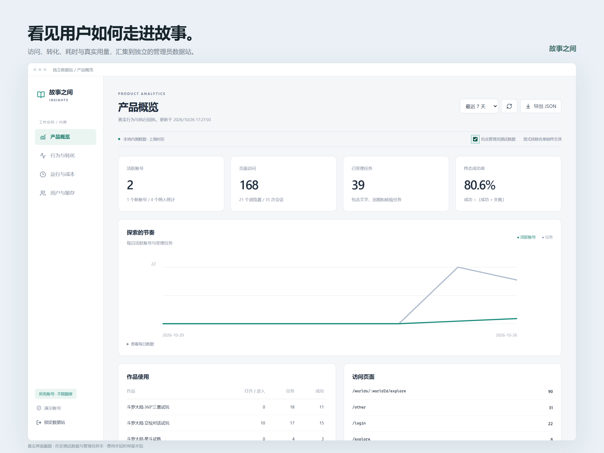

<div align="center">

# 故事之间 · Story Between

**把小说读成一个可以走进去、与人交谈、留下选择的世界。**

Self-hosted AI interactive stories with 360° exploration, character dialogue, visual authoring, and branching worlds.

[](LICENSE)
[](https://github.com/yongze233-ctrl/story-between/actions/workflows/ci.yml)


[快速开始](#快速开始) · [界面预览](#界面预览) · [模型配置](#模型配置) · [开发与测试](#开发与测试)


</div>

故事之间把阅读器、角色聊天、互动世界和作者工作台连在一起。你可以导入自己的小说，整理人物与知识，选择身份进入故事；也可以从一个原创世界开始，把开局、人物、物品、任务和结局交给自己的设定。

它仍是 **Web Beta**：适合自部署体验和小规模内测。`mock` 模式用于验证产品流程；真实文本、出图与视觉核验需要部署者配置自己的供应商通道。

## 可以做什么

| 能力 | 当前实现 |
| --- | --- |
| 阅读与导入 | 账号书架、小说导入、章节阅读、笔记与阅读进度 |
| 进入故事 | 选择人物、观察、行动、调查、角色对话与流式回复 |
| 360° 场景 | 环境全景、小地图、画面中的地区路口、确认移动、出图与恢复入口 |
| 角色形象 | 头像、人物图、透明立绘；对话时只展示当前交谈对象 |
| 作者工作台 | 世界与人物、知识、多开局、可视化表单/状态栏、任务与结局、保存后试玩 |
| 模型与记忆 | 平台默认模型、可选个人通道、游玩中的模型切换、记忆编辑与历史恢复 |
| 世界外聊天 | 使用角色快照独立聊天，支持记录与记忆导出/恢复，与主线状态隔离 |
| 分支与存档 | 检查点、世界线分叉、历史回看、备份和恢复 |
| 发布与账号 | 公开作品、审核、独立玩家副本、账号和显式管理员权限 |
| 独立数据站 | 活跃、访问、转化、行为、耗时、用量、错误、留存及 JSON 导出 |

核心设计是让**正式状态有依据，视觉呈现可独立恢复**：立绘和场景核验不应改写主线，世界外聊天不应替玩家选择结局，未确认的供应商请求不自动重复发送。

## 界面预览

| 作品探索 | 360° 环境与立绘对话 |
| --- | --- |
|  |  |
| 作者可视化画布 | 独立数据站 |
|  |  |

截图来自真实本地界面，账号已匿名化；作者图展示未保存的配置示例。场景图展示已生成的演示资产，自部署后的账号、存档和私人图像需自行创建。

## 快速开始

需要 **Docker Compose v2** 和 **Python 3.12+**（生成配置用）。

```bash
git clone https://github.com/yongze233-ctrl/story-between.git
cd story-between
python scripts/init-env.py
docker compose up -d --build
```

1. 打开 **[产品站 http://127.0.0.1:8810](http://127.0.0.1:8810)**，注册你自己的账号。没有公共默认密码。
2. 显式指定这个账号为管理员，并初始化内置示例：

```bash
docker compose exec api python -m app.cli grant-admin --username YOUR_USERNAME
docker compose exec api python -m app.cli seed-demo --username YOUR_USERNAME
```

3. 刷新产品站，即可打开《蓝宝石案》《钟楼失约》《雪关同行》等示例。默认 `mock` 模式使用确定性模拟文本，不调用付费模型。
4. 打开 **[独立数据站 http://127.0.0.1:8812](http://127.0.0.1:8812)**，使用同一个管理员账号。普通账号没有数据访问权限。

`init-env.py` 为每次新部署生成独立密钥，不打印密钥，也不会覆盖已有 `.env`。数据库和私人文件使用持久卷；更新代码后运行 `docker compose up -d --build`。请保留自己的 `.env` 和持久卷。

## 模型配置

体验真实 AI 时，将 `.env` 中的 `AI_MODE` 改为 `real`，重新启动 API 和 worker。管理员在产品中配置自己的文本、图像和视觉核验通道，再在运营后台设置为平台默认模型。后续用户自动获得默认通道，无需逐人填写密钥。

- **文本与视觉**：当前提供 Chat Completions 风格的适配与安全主机白名单，模型能力需与配置匹配。
- **图像**：当前场景出图使用内置 Agnes 适配。其他图像服务需新增适配，不是填写任意 OpenAI 图像地址即可通用。
- **自定义供应商**：同时更新 `PROVIDER_ALLOWED_HOSTS`，并核对其协议、上下文与输出参数。
- **额度**：`PRODUCT_UNLIMITED_USAGE=true` 覆盖产品内的积分、累计文本/token、图像日限额和作者试玩限额。**产品内不限额度不代表供应商免费或没有限流。**

密码、访问令牌、模型密钥和对话正文不会进入行为埋点。图像和场景结果与主线分开保存；调用结果未知时保留原记录，避免自动重发产生重复费用。

## 架构

```text
client/                    Vue 3 + TypeScript + Vite
  src/world/               世界游玩、360° 环境、立绘与小地图
  src/authoring/           作者配置、表单画布、发布与试玩
  src/play-controls/       模型、记忆与世界外聊天
  src/insights/            独立数据站
server/
  app/world/               正式状态、检查点、世界线、任务执行
  app/scenes/              图像、视觉核验、渐进加载与恢复
  app/foundation/          账号、权限、默认模型、埋点、用量
  app/authoring/           作者与发布流程
  migrations/              Reader 数据库迁移
tests/                     浏览器和契约场景
integrations/              可选支付适配与底座来源记录
```

后端为 FastAPI、SQLAlchemy 与 PostgreSQL。Reader 与 World 使用分开的迁移边界；文本执行器、世界执行器和场景队列负责异步工作。数据站独立提供页面，分析 API 使用管理员鉴权和只读查询。

## 开发与测试

前端需要 Node.js 22；后端需要 Python 3.12/3.13 与 PostgreSQL 16。

```bash
cd client
npm ci
npm run typecheck
npm run test:unit
npm run build
```

测试后端必须使用**新建且名称以 `_test` 结尾的专用数据库**，并设置 `AI_MODE=mock`。测试会清空该测试数据库，不能指向已有用户数据。完整环境和本版本 349 项后端回归命令见 [.github/workflows/ci.yml](.github/workflows/ci.yml)。

本开源快照在独立目录完成依赖安装、前端 1,461 项测试、类型检查和生产构建；后端回归与全新账号初始化亦按实际结果登记在 [发布验证](docs/RELEASE.md)。GitHub Actions 会持续验证。

### 本地开发服务

已有 Compose 后端时，在 `client/` 中设置 `DEV_API_TARGET=http://127.0.0.1:8810`，使用 `npm run dev -- --port 18868` 开发产品页；使用 `npx vite --config insights.vite.config.ts` 开发独立数据站。PowerShell 中先运行 `$env:DEV_API_TARGET='http://127.0.0.1:8810'`。

## 当前边界

- 生成速度、人物外观和复杂场景质量仍依赖供应商与提示词；不保证任意长篇小说都能一次构建成完整、无冲突的世界。
- 独立数据站的新行为只从接入后开始记录。默认排除管理员，显式排除名单始终生效；供应商未返回的费用保留未知，不从积分估算。
- 邮件验证/邮件找回未作为本版本的可用能力交付；支付和对象存储是可选集成，需要自行配置与验收。
- Android/iOS 项目保留开发源码，本次 Web 验证不代表移动端构建或真机验收通过。
- 本仓库不包含维护者的私人小说、测试账号、供应商密钥、数据库、生成缓存或个人部署配置。

## 参与与许可

欢迎提交 Issue 和 PR，说明问题、复现过程与期望行为。贡献说明见 [CONTRIBUTING.md](CONTRIBUTING.md)，敏感问题见 [SECURITY.md](SECURITY.md)。

代码使用 **[MIT License](LICENSE)**。依赖、示例文本、生成插画和同人演示素材的说明见 [NOTICE.md](NOTICE.md)。
